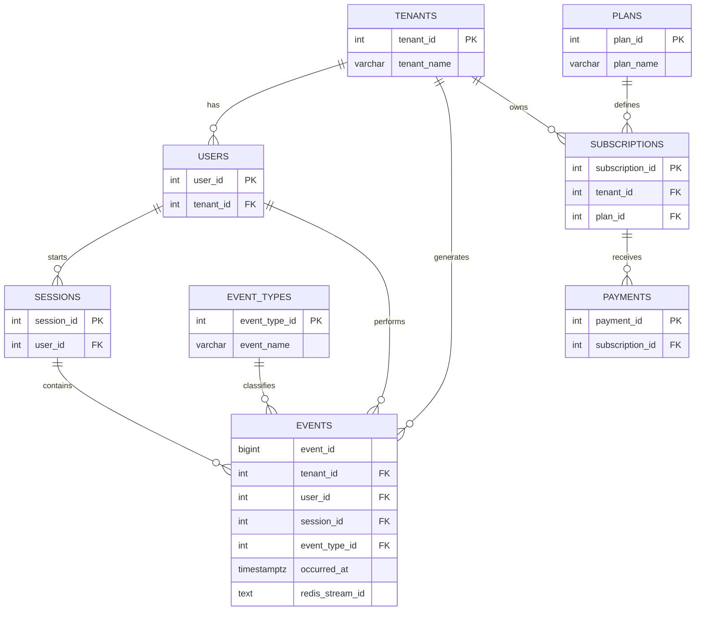

# Database Week 8 - Entity Relationship Diagram

## Real-Time Analytics Platform

The diagram shows the main entities and their relationships.

## Explanation

- TENANTS: Stores customer organizations.
- USERS: Stores users belonging to tenants.
- SESSIONS: Records user sessions.
- EVENT_TYPES: Defines event categories.
- EVENTS: Stores application activity and timestamps.
- PLANS: Stores subscription plans.
- SUBSCRIPTIONS: Connects tenants to plans.
- PAYMENTS: Records subscription payments.

The events table uses PostgreSQL range partitioning on occurred_at.
